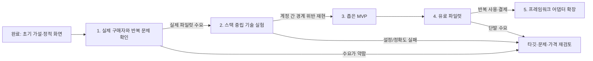

# 권한 경계 검증 도구 — 사업 우선 로드맵

**기준일:** 2026-11-10

**현재 상태:** 공개 릴리스는 v0.2.0이다. 내장 loopback 예제 실행 기능을 담은 v0.3.0은 로컬에서 구현·빌드했으며 아직 공개하지 않았다.

## 제품 방향

Supabase 전용 도구로 고정하지 않는다. 제품 문제를 특정 데이터베이스가 아니라 **로그인한 사용자·역할·조직 사이의 접근 경계가 지켜지는지 증명하는 것**으로 정의한다. 초기 유스케이스는 다른 사용자의 데이터 열람/수정(IDOR/BOLA), 역할 상승, 테넌트 경계 침범 같은 권한 오류다.

다만 “모든 스택의 모든 취약점을 찾는 AI 스캐너”로 넓히는 것도 현실적인 첫 제품이 아니다. 기존 DAST 도구가 이미 넓은 취약점 탐지를 제공하고, 인증·탐색 설정에 전문성이 필요하다. 이 제품은 승인된 스테이징 앱에서 여러 계정으로 같은 작업을 재실행하고, 사용자가 확인한 기대 권한 규칙과 결과를 대조해 재현 가능한 보고서를 제공하는 데 집중한다.

**초기 기술 가설:** HTTP 요청을 여러 테스트 신원으로 재생하는 공통 엔진 + 사용자가 제공하는 역할/기대 규칙 + 이후 플랫폼별 연결 도구(adapter). 이 방식이면 Supabase만을 전제로 하지 않으면서도 임의로 모든 앱의 권한 의도를 추측하지 않는다. 어느 프레임워크를 첫 지원 대상으로 삼을지는 실제 잠재 고객 인터뷰 후 결정한다.

## 진행 흐름

## 단계별 실행

### 0단계 — 시작 자료

- 사업성 프로젝트 보고서 및 AI 가상 페르소나 10명 반론 검토
- 임시 가격 가설: 단건 $19, 제작사 월 $49/최대 5개 프로젝트, 추가 프로젝트 월 $9
- 브라우저에서 Supabase SQL 파일을 읽는 정적 프로토타입
- 가상 API 흐름으로 계정 A/B 접근 결과와 샘플 보고서를 보여주는 스택 중립 데모

가상 페르소나는 실제 구매자 검증이 아니며 수요나 전환율의 증거로 사용하지 않는다. 현재 화면도 Supabase만 다루므로, 새 제품 방향을 검증하는 데모로는 부족하다.

### 1단계 — 페르소나 기반 가설 점검 및 데모

실제 제작자를 지금 모집하기 어렵다는 제약을 반영해 AI 가상 페르소나 10명으로 문제·대안·가격 가설의 약점을 우선 검토한다. 이 검토는 문서와 데모로 넘어갈지 정하는 임시 게이트이지 실제 수요 검증은 아니다.

모의 검토 결과, 반복 납품하는 소규모 앱 제작사/에이전시를 잠정 타깃으로 두고 “납품 전 다중 계정 권한 확인 + 증거 보고서” 데모를 만들었다. 앱 스택은 Supabase로 제한하지 않는다. 현재 데모는 가상 결과만 보여주며 실제 API를 호출하지 않는다.

사용자는 현재 외부에 데모를 보여주지 않고 기술 작업을 먼저 진행하기로 했다. 사업 가설은 아직 검증되지 않았으며, 데모 공유와 실제 구매자 피드백은 이후 단계로 미룬다.

**통과 기준:** 가상 페르소나 반응 수를 전환율처럼 사용하지 않는다. 이 단계에서 가능한 결론은 기술 데모 진행 여부뿐이다. 유료 제품 출시나 시장성 입증은 실제 앱 제작자의 사용·결제 반응이 생긴 뒤에 판단한다.

### 2단계 — 기술 위험 검증

범용 크롤링/취약점 자동발견부터 만들지 않는다. 우선 직접 만든 루프백 fixture에서 HTTP 권한 검사 흐름을 검증한다. 실제 승인 스테이징 앱 적용은 별도 단계다.

- 두 테스트 신원(A/B)으로 동일한 읽기·수정 요청을 재생한다.
- A가 B의 자원에 접근할 수 없어야 한다는 기대 규칙을 사용자가 명시한다.
- 요청·응답 차이와 실제 접근 가능 여부를 증거로 남긴다. 차이가 있다는 사실만으로 취약점이라고 단정하지 않는다.
- 처음에는 read-only 검사만 수행하고, 쓰기 검사는 명시적 승인과 테스트 데이터가 있는 환경에서만 한다.
- 설정 시간, 지원이 필요한 인증 방식, 오탐·누락을 측정한다.

통과하면 공통 HTTP 재생 엔진을 유지하고 첫 고객군이 실제 사용하는 스택 연결 방식을 고른다. 실패하거나 수동 설정이 과도하면 제품 범위/구매자 가설을 다시 본다.

### 3단계 — 좁은 MVP

- 승인된 스테이징 URL 및 테스트 계정 입력
- 브라우저 프록시 또는 OpenAPI/기존 요청 기록 등 한 가지 명확한 트래픽 입력 방식
- 사용자 지정 역할/자원/기대 접근 규칙
- 선택된 요청의 신원 간 재생과 비교
- 증거, 실행 범위, 미검사 항목, 수정 후 재검사가 포함된 보고서
- 로컬 우선 자격 증명 보관과 테스트 범위 제한

첫 입력 방식과 지원 스택은 1단계 고객 자료를 보고 고른다. 초기에는 자동 취약점 전체 스캔, AI 자동 수정/배포, 모든 프레임워크 지원, 보안 인증 배지를 약속하지 않는다.

### 4단계 — 유료 파일럿

2~3개 제작사에서 실제 고객 소유 또는 명시적으로 승인된 스테이징 앱으로 사용한다. 온보딩 시간, 테스트 구성 성공률, 발견의 재현성, 고객 보고서 전달 여부, 재사용과 갱신 의사를 기록한다. 첫 가격은 임시값으로 제시하고 지불 반응에 따라 조정한다.

적어도 2곳이 다음 프로젝트에서도 재사용하거나 갱신하는지 확인한다. 단건 구매만 있으면 구독형 대신 프로젝트별 점검 도구/서비스가 맞는지 검토한다.

### 5단계 — 스택 확장

유료 반복 사용이 확인된 뒤 실제 고객 비중이 큰 순서로 어댑터를 추가한다. 예: OpenAPI 기반 API, 브라우저 캡처 요청, 프레임워크별 테스트 계정 생성. Supabase는 첫 구현 후보 중 하나일 뿐 제품 경계가 아니다.

## 지금 할 일

1. 로컬 v0.3.0 패키지에서 안전·취약 예제 결과가 기대한 대로 표시되는지 확인한다.
2. 다음 세션에서 실행 결과를 로컬 보고서로 저장하고 다시 여는 흐름을 구현한다.
3. 학생·지인 사용성 테스트는 기능 흐름이 이해되는지 확인하는 용도로 진행한다.
4. 실제 제작자 사용·유료 파일럿은 사업성 검증 단계로 유지한다. 지금의 학생·지인 테스트는 이를 대체하지 않는다.

## 근거와 한계

- OWASP는 권한 회귀 테스트에서 IDOR와 테넌트 경계 문제를 반복 검증하는 접근을 설명한다: [Authorization Regression Testing Cheat Sheet](https://cheatsheetseries.owasp.org/cheatsheets/Authorization_Regression_Testing_Cheat_Sheet.html)
- OWASP ZAP은 API 및 인증된 앱 스캔을 지원한다. 따라서 “인증 스캔이 없다”는 주장은 차별점이 될 수 없다. 사용자가 설정한 기대 접근 규칙에 따라 신원 간 행위를 비교하는 작업 흐름이 실제로 더 쉽고 가치 있는지 검증해야 한다: [ZAP API](https://www.zaproxy.org/docs/api/), [ZAP API scan](https://www.zaproxy.org/docs/docker/api-scan/)
- 기존 도구가 있다고 해서 고객이 이 제품을 원한다는 뜻도, 원하지 않는다는 뜻도 아니다. 반복 문제·설정 비용·지불 의사는 인터뷰와 유료 파일럿으로 확인한다.
- 제3자 시스템 무단 스캔은 범위에서 제외한다. 제품은 소유 또는 명시적으로 승인된 테스트 환경에만 작동해야 한다.

## 진행 현황 갱신 — 2026-11-09

실제 제작자에게 데모를 보여주는 단계는 보류하고 핵심 기술을 먼저 확인한다. `poc/`는 loopback IP만 허용하며 기본 GET, 명시적으로 켠 fixture PATCH를 실행한다. 계정별 Bearer/Cookie 헤더, 환경 변수로부터의 비밀값 참조, 기대 본문 표식과 금지 본문 표식을 지원한다. 응답 본문은 최대 64 KiB만 확인하고 원문은 보고서에 저장하지 않는다. 404 거부 판정은 같은 경로에 대한 다른 계정의 허용 대조 요청이 성공해야 통과한다. PATCH는 loopback 대상·시나리오 허용·CLI 허용·fixture 허용을 모두 요구한다.

2026-11-09 로컬 검증 결과: 안전 fixture는 3 pass/0 review, 의도적 교차 테넌트 유출 fixture는 2 pass/1 review, 403 상태 본문 유출 fixture도 2 pass/1 review였다. 존재하지 않는 경로의 404는 소유자 대조 확인이 실패해 `inconclusive`로 분류됐다. 보고서는 `poc/results/`에 별도 저장했다. 이 결과는 고정된 로컬 예제의 성공만 의미하며 시장성이나 실제 앱 검사 정확도를 증명하지 않는다.

역할 상승 시나리오 추가 후 안전 fixture는 5 pass/0 review, 역할 검사만 비활성화한 fixture는 4 pass/1 review였다. 일반 Acme 사용자가 관리자 전용 감사 로그를 읽는 요청을 검사기가 탐지했다. 보고서는 `poc/results/secure/` 및 `poc/results/role-vulnerable/`에 있다.

제한된 쓰기 시나리오에서는 안전 fixture가 2 pass/0 review, 테넌트 쓰기 권한을 우회한 fixture가 1 review/1 inconclusive였다. 역할별 쓰기 시나리오에서는 안전 fixture 4 pass/0 review, 역할 검사 우회 fixture 2 pass/1 review/1 inconclusive였다. 일반 사용자의 관리자 감사 로그 변경을 검토 대상으로 잡고, 관리자 변경은 허용했다. 쓰기 opt-in이 없으면 PATCH를 건너뛰었다. 쓰기 데이터는 서버 메모리에만 남고 서버 재시작 시 초기화된다. 결과 요약은 `poc/results/`에 있다.

HAR importer는 합성 파일에서 5개 요청 중 선택 origin 4개를 확인하고, `/api/` 하위에서 GET 1종과 PATCH 1종 템플릿으로 중복 제거했다. Authorization/Cookie, 쿼리 문자열, 요청·응답 본문에 둔 가짜 비밀 표식이 초안 출력에 포함되지 않는 것을 확인했다. 경로 숫자 ID는 `{redacted}`가 되고 산출물은 실행 불가 초안으로 표시됐다.

OpenAPI importer는 합성 3.1 명세에서 선택한 서버 경로와 접두사 안의 GET/PATCH 5개 operation을 추출했고 PUT은 생략했다. 명세에 넣은 보안 키 예시·operation 설명·요청 본문 예시는 초안에 출력되지 않았다. 비교 결과 HAR는 실제 관찰 범위/인증 흐름에 유리하고 OpenAPI는 실행되지 않은 선언 경로를 찾는 데 유리하므로, 사용자 기대 접근 규칙을 정하는 별도 단계가 양쪽 모두에 필요하다.
